<h1 align="center">Hola, soy César 👋</h1>

  Estudiante de Física · física computacional · olimpiadas de química ⚗️

  
  

## 📊 Mis estadísticas

  
  

## 📈 Actividad

  

## 🐍 Contribuciones

  <picture>
    <source media="(prefers-color-scheme: dark)" srcset="https://raw.githubusercontent.com/EnDriS10/EnDriS10/output/snake-dark.svg">
    
  </picture>

